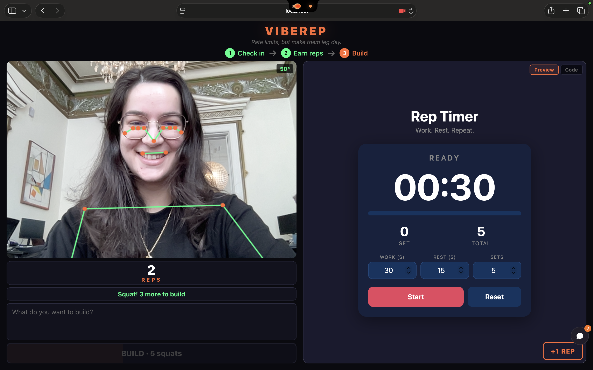

# VIBEREP

### Rate limits, but make them leg day.

> What if the only API key was your quads?

VibeRep is an AI coding tool where you **pay for prompts in squats**. No credit card. No free tier. Just legs.

Check in at the gym. Do squats in front of your webcam. Earn reps. Spend them to have Claude build you a web app. Skip leg day? No code for you.


---

## Demo

<!-- REPLACE with your video URL after uploading to a GitHub issue -->
<!-- Drag demo.mov into any GitHub issue comment, copy the generated URL, paste here -->
https://github.com/user-attachments/assets/PASTE-VIDEO-URL-HERE



---

## How it works

```
1. Check in     Scan your gym pass (or click the button, we won't judge)
2. Earn reps    Do squats — the webcam tracks your knees via MediaPipe
3. Build        5 squats = 1 prompt to Claude, which writes you a full web app
```

The app uses [Limitr](https://github.com/nickhershkowitz/limitr) for billing — except the currency is physical exercise. Your balance goes up when your knees go down.

Spacebar adds a rep from anywhere in the app (unless you're typing a prompt, obviously). The +1 REP button in the corner is for people who don't believe in keyboard shortcuts.

## Setup

```bash
npm install
cp .env.example .env.local
```

Paste your Anthropic API key into `.env.local`. Get one at [console.anthropic.com](https://console.anthropic.com).

```bash
npm run dev
```

Open [localhost:5173](http://localhost:5173) and start squatting.

## Tests

```bash
npm run test        # 5 Vitest unit tests (billing logic)
npm run test:e2e    # 12 Playwright E2E tests (the app, with mocked AI)
```

The E2E suite covers double-click race conditions, rep spam, camera denial, API failures, garbage HTML from the AI, viewport overflow, and more. Because if your legs can handle the stress, your code should too.

## Stack

- **React 19** + **Vite** — the app
- **MediaPipe Pose** — squat detection via webcam
- **Claude claude-sonnet-5-5** — builds the web app from your prompt
- **Limitr** — rate limiting engine (credits = squats)
- **Vitest** + **Playwright** — tests

## Philosophy

Gyms say "don't vibe code between sets." We say: **make vibe coding the set.**

---

Built at [Entrepreneur First](https://www.joinef.com) London.
